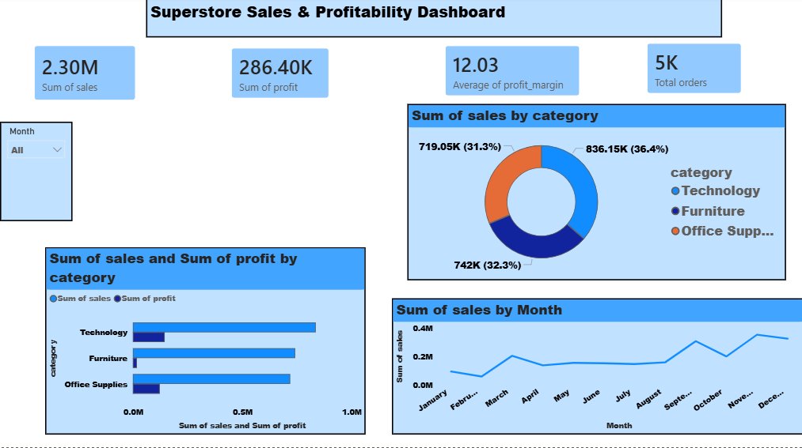

# Superstore Sales & Profitability Analysis

**Uncovering what drives — and drains — profitability across 5,009 orders**

---

## Project Overview

This project analyzes 5,009 orders (9,994 line items) from the Sample Superstore dataset to uncover what's actually driving — and draining — profitability across categories, discount levels, regions, and customer segments. The standout finding: profitability turns negative as soon as discounts pass the **20% mark**, giving a clear, data-backed rule for future pricing decisions.

**Pipeline:** `Python (Pandas) → MySQL → SQL analysis → Power BI dashboard → PDF report`

---

## Business Objectives

- Understand what drives sales and profitability across categories and regions
- Identify which discount levels destroy profit
- Find loss-making states and sub-categories
- Build an interactive Power BI dashboard for stakeholders

---

## Project Files

| File | Description |
|------|-------------|
| `data/Superstore.csv` | Raw dataset (9,994 rows, 21 columns) |
| `data/Superstore_cleaned.csv` | Cleaned dataset (regenerated from the notebook) |
| `notebooks/Superstore.ipynb` | Data cleaning & feature engineering notebook (Pandas) |
| `sql/superstore queries.sql` | 10 business insight SQL queries against the MySQL `orders` table |
| `dashboard/superstore dashboard.pbix` | 3-page interactive Power BI dashboard |
| `report/Superstore_Sales_Profitability_Report.pdf` | Full written report with charts and recommendations |
| `assets/dashboard.png` | Dashboard screenshot (featured above) |

---

## Key Statistics (for interview prep)

| Metric | Value |
|--------|-------|
| Total rows | 9,994 |
| Unique orders | 5,009 |
| Columns | 21 |
| Missing values | 0 |
| Duplicate rows | 0 |
| Total sales | $2,297,200.86 |
| Total profit | $286,397.02 |
| Overall margin | 12.47% |
| Raw average profit margin | 12.03% |

---

## Data-Quality Gate — Interview Checks

These are the specific checks an interviewer may ask about. Be ready to answer each one:

| Check | What It Proves | Status |
|-------|---------------|--------|
| No duplicate rows | Data integrity verified before analysis | 0 duplicates found |
| No nulls | All fields populated | 0 nulls in cleaned data |
| Column names standardized | snake_case for MySQL/Power BI compatibility | All columns renamed |
| Postal codes | Leading zeros preserved (449 ZIPs starting with 0) | zfill(5) applied |
| Dates parsed | Order Date and Ship Date as datetime | mm/dd/yyyy format |
| Feature engineering | shipping_duration, profit_margin, cost, is_loss created | All added |
| SQL query correctness | All 10 queries run and return expected results | Verified against data |
| Database connection | MySQL connection via `.env` credentials | Working |

---

## SQL Analysis — 10 Business Questions

| # | Question | Key Result |
|---|----------|------------|
| Q1 | Total revenue, profit, margin | $2.30M sales, $286.4K profit, 12.47% margin |
| Q2 | Most/least profitable categories | Technology most profitable, Furniture least |
| Q3 | Loss-making sub-categories | Tables, Bookcases, Supplies |
| Q4 | Discount vs profitability | Margin turns negative after 20% |
| Q5 | Loss-making states | Texas, Ohio lead the losses |
| Q6 | Regional comparison | West leads sales & profit |
| Q7 | Customer segment value | Consumer segment most valuable |
| Q8 | Highest-value customers | Top 10 by total spend |
| Q9 | Shipping vs margin | Standard Class drives most profit volume |
| Q10 | Seasonality | Sept–Dec strongest months |

See `sql/superstore queries.sql` for the full query set.

---

## Data Cleaning (Python/Pandas)

| Step | Action | Result |
|------|--------|--------|
| Encoding | Read with cp1252 (UTF-8 crashes on non-breaking space) | Loaded successfully |
| Duplicates | Verified none exist | 0 duplicates |
| Dates | Order Date & Ship Date → datetime | mm/dd/yyyy parsed |
| Postal Code | Cast to text, restore leading zeros | 449 ZIPs fixed with zfill(5) |
| Whitespace | Trimmed all text columns | 16 Product Name trailing spaces fixed |
| Column names | Standardized to snake_case | All columns renamed |
| Features | shipping_duration, profit_margin, cost, is_loss | 4 new columns |
| Nulls | Verified none | 0 missing values |

---

## Power BI Dashboard

A 3-page interactive dashboard built on the cleaned dataset:

1. **Overview** — KPI cards, sales & profit by category, segment split, monthly trend
2. **Profitability Deep-Dive** — sub-category profit ranking, discount vs. margin, discount band analysis
3. **Regional & Operational Performance** — state/region profitability table, shipping mode analysis, top customers

---

## Key Insights

- **$2.30M** total sales, **$286.4K** total profit, **12.47%** overall margin
- Profit margin turns negative once discounts pass **20%** — the 21–40% band averages **-16.7%**, and orders discounted 40%+ lose money at a **-108.9%** average margin
- **Furniture** generates nearly as much revenue as Office Supplies but returns 6–8x less profit
- Ten states — led by **Texas** and **Ohio** — are net loss-making despite solid sales volume
- 📅 Clear seasonality, with **Sept–Dec** consistently the strongest months for sales and profit

---

## Recommendations

- Cap discounts at 20% on Furniture and Office Supplies orders
- Review Furniture pricing, particularly Tables and Bookcases
- Investigate Texas and Ohio operations for region-specific discounting or cost issues
- Plan promotions and inventory around the Sep–Dec peak season

---

## Tools Used

`Python` · `Pandas` · `SQLAlchemy` · `MySQL` · `Power BI` · `DAX`

---

## About the Author

**Hassan Jumaa (Riq)**

Data Analyst | [Portfolio](https://riq-wq.github.io/Myportfolio) · [LinkedIn](https://linkedin.com/in/mrisa-juma-56a600416) · [GitHub](https://github.com/Riq-wq)
